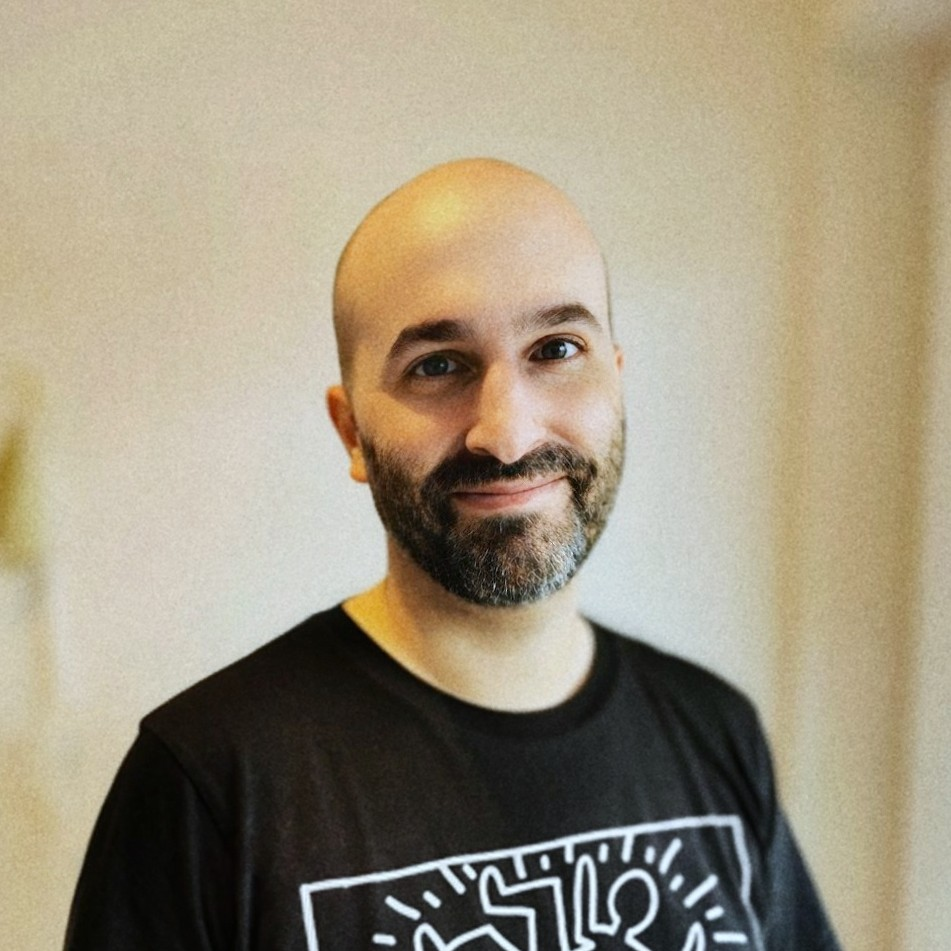

# Pedro M.C. Fernandes

## Product Designer

[Contact me at www.pmcf.xyz](/)
<a href="https://linkedin.com/in/pmcfernandes" target="_blank">linkedin.com/in/pmcfernandes</a>

I'm a systems-thinking Product Designer who transforms stagnating products into growth engines by fixing ecosystems, not just interfaces. I operate at the intersection of Product Strategy and execution, defining visions that influence executive roadmaps while shipping production code that helps scale teams and operations. My specialty is diagnosing why products underperform, then building the frameworks and systems that unlock their potential.

### 12 years as a Product Designer

I specialize in Product Strategy, Design Systems, User Research, and Stakeholder Management. At Percona, I contributed to 45% PMM adoption growth through systematic UX improvements. At Farfetch, I shifted sustainability from a cost center to a business opportunity through research-driven discovery improvements. At TUI Group, I designed systems generating 100K+ pages supporting 4x organic traffic growth. I thrive in ambiguous 0→1 spaces where I can own strategy as well as delivery, building systems that become force multipliers for teams.

### 9 years of Systems-Thinking & Technical Leadership

I build scalable systems adopted across multiple product and engineering teams, reducing handoff and front-end development time. I've established analytics frameworks enabling data-driven decisions, shipped production code for internal platforms, and led user-facing documentation redesigns across 10+ products. My systematic approach ensures 99% implementation accuracy through self-serve components and developer tooling, creating predictable and cost-effective workflows.

### 9 years of Cross-functional Leadership & Mentorship

I mentor designers and engineers, establishing research practices, design excellence standards, and modernized front-end practices. I influence executive strategy with compelling vision prototypes and extensive User Research, securing buy-in for roadmap initiatives. I've co-founded innovation hubs, scaled teams, and managed external development partnerships ensuring high implementation quality across distributed teams.

### 18 years of Design Thinking

I've worked across visual design, graphic design, web design, industrial design, and illustration. I've designed and coded interconnected products showcased at CES, secured European Community funding, and mastered e-commerce reaching 50+ countries. My foundation spans Enterprise UX, Front-end Development, and multi-market product deployment across B2B and B2C contexts.